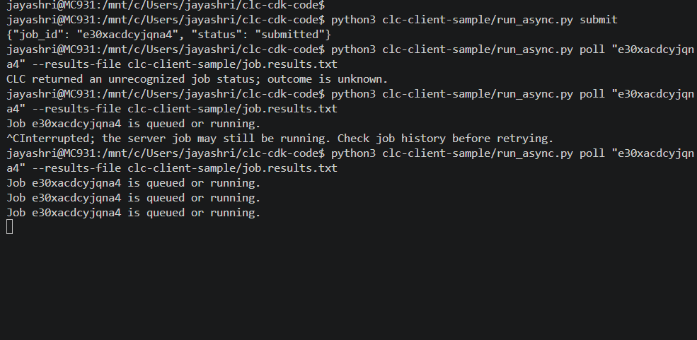

# Standalone CLC analysis

This sample installs the CLC Server Command Line Tools if needed and runs a
paired-read cloud workflow synchronously against an existing CLC server.

## Setup

Use Python 3.10+ and Bash on Linux (Bash is only needed for installation).
Install the Python dependency from the repository root:

```sh
python3 -m pip install python-dotenv==1.1.1
```

This dependency is also included in the repository's [requirements.txt](../requirements.txt).

Configure [.env](./.env) inside this folder. For a fresh checkout, copy
[env.example](./env.example) to `.env`. Set the host, port, user, password,
workflow, preset, installer, installation directory, and input file there.
The password is deliberately blank: supply it locally or export `CLC_PASSWORD`
through your approved Vault integration. Shell variables override `.env`.
Values are literal (no `${VARIABLE}` expansion); quote values containing spaces
or `#`. Prefer a least-privileged service account.

Relative configured paths resolve from this folder, not the working directory.
Absolute paths also work. Keep the compatible installer in the configured
location. The default connection expects a local tunnel on `127.0.0.1:7778`.
CLC must be able to read the input S3 objects and write the destination prefix.

Set `read1`, `read2`, and `destination` in the configured input JSON.
See [input.example.json](./input.example.json) for the format. Use distinct
paired FASTQ URLs and an S3 destination prefix ending in `/`. The runner checks
that these fields are non-empty strings; the CLC client validates their values.
Do not commit credentials or sample-identifying paths. The local `.env`,
input, installer, and installation directory are ignored by Git.

## Run

From the repository root:

```sh
python3 clc-client-sample/run.py
```

The client is installed once and reused. An incomplete installation is not
overwritten: inspect it before retrying. To override the installer:

```sh
python3 clc-client-sample/run.py /path/to/installer.sh
```

The runner waits for CLC to finish and propagates its exit status. It does not
retry or submit asynchronously. On failure or interruption, check CLC job
history and restricted server logs before retrying to avoid duplicate jobs.
Raw output is suppressed because it can contain sensitive data; for synthetic,
non-sensitive data only, stream it live with:

```sh
python3 clc-client-sample/run.py --show-test-output
```

The CLI requires the password in `-W`, so it is visible in process arguments
while running. Use an isolated host, restrict access to `.env`, and never
commit it. The runner does not print the command or password.

The legacy [run.sh](./run.sh) is not used by this runner and does not load
`.env`; use the Python command above.

## Asynchronous submission and polling

For the proposed Lambda and Step Functions design, see the
[asynchronous analysis orchestration plan](./step-functions-plan.md).
It separates submission and single-request status checks from state-machine waiting
and keeps result retrieval outside the polling loop.

[run_async.py](./run_async.py) uses the same `.env`, input format, client
installation, and workflow arguments as the synchronous runner.

Submit once:

```sh
python3 clc-client-sample/run_async.py submit
```

Successful submission prints JSON to stdout, for example:

```json
{"job_id": "<process-id>", "status": "submitted"}
```

Save the returned ID. `submitted` means the server accepted the command, not
that the analysis completed. If submission fails, times out, or returns no
unique ID, check job history before retrying; the job may already exist.
The CLI can return the ID as `Message: Process ID: <id>`; the runner accepts
both that format and plain `Process ID: <id>`. If an older runner reported
`no unique Process ID field`, do not resubmit automatically. Find the existing
CLC process ID using the client's `-I` listing or server job history, and poll
that ID instead (not the underlying AWS Batch job ID).

Poll that ID using the same server and account:

```sh
python3 clc-client-sample/run_async.py poll "<process-id>" \
  --results-file clc-client-sample/job.results.txt --interval 30 --timeout 86400
```

`--results-file` is required and resolves from the current working directory.
Use a new path for each job; existing files are never overwritten. On Linux,
the file is created with owner-only permissions. It contains the final CLI
result summary and output locations, not downloaded analysis data.
Files ending in `.results.txt` inside this sample folder are ignored by Git;
do not commit result summaries written elsewhere.

Polling uses `-I` every 30 seconds by default, with a 24-hour overall deadline
and at most 60 seconds per CLI request. It checks `Job ID`, `Job is done`,
and `Job has errors`, accepting the CLI's `Yes`/`No` values as well as
`true`/`false`. On error-free completion, it retrieves results once
using `-R` and saves the summary before reporting `successful`. Failed jobs
report `failed`. A polling deadline reports `timeout`; the job may still run.
Progress and errors go to stderr, while terminal responses go to stdout as JSON.

### Example terminal session



The screenshot shows a submitted job and polling while it is queued or running,
not a completed analysis. The initial status-format error was fixed by accepting
`Yes`/`No` values. Interrupting polling does not cancel the server job; polling
can be resumed with the same job ID.

Exit codes: `0` for submission/success, `1` for a failed job, `2` for monitoring,
configuration, retrieval, or timeout errors, and `130` for interruption.
The script never automatically retries, cancels, or resubmits jobs.

**Result retrieval is one-time:** `-R` consumes the server's retrievable result
record. After retrieval or a retrieval error, consult the saved summary and
job history before running polling again. A reserved empty result file may
remain after a timeout or retrieval failure; do not delete it and blindly retry.
Raw CLI errors are suppressed; use restricted server logs for diagnostics.

See the [QIAGEN CLI manual](https://resources.qiagenbioinformatics.com/manuals/clcservercommandlinetools/current/index.php?manual=Basic_usage.html)
for the documented `-Y`, `-I`, and `-R` options.

## Test

Tests use a temporary configuration and mocked processes; no CLC jobs are submitted.

```sh
python3 -m unittest discover -s clc-client-sample -p "test_run*.py"
```
